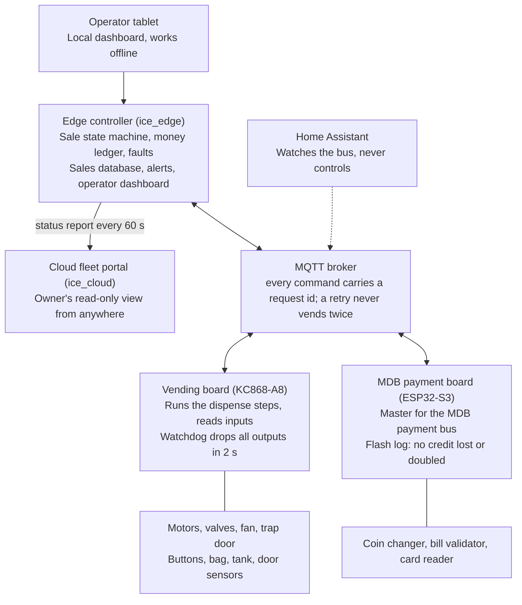

# ice-colder Project Overview

As of 2026-10-19. A plain-language companion to [OVERVIEW.md](OVERVIEW.md), which is the detailed map with links to every design document.

## What it is

ice-colder is the software that runs a bagged-ice and water vending machine (the Kooler Ice IM600XL is the reference machine). It takes money, sells a product, drives the hardware that drops a bag of ice or fills a jug, and tells the owner what is going on.

The design goal is a machine that keeps selling no matter what. Hardware faults, a lost network, a crashed process or a corrupt database each degrade one thing and never stop the machine from taking money or giving it back.

It is one Git repository with three kinds of code: firmware for two small ESP32 boards that own the hardware, a Python controller (the "edge") that runs on a small computer inside the machine, and a small cloud service the owner can view from anywhere.

## The three layers

The system is split so that each layer keeps working when the one above it goes away.

Decisions about money and sales live on the edge. The boards do what they are told and stay safe on their own. The cloud receives a report and never sends a command.

- **Boards.** Two ESP32 microcontrollers inside the machine. The vending board drives the motors, valves, fan, trap door and heater and reads the buttons and sensors. The MDB board talks to the coin changer, bill validator and card reader over the vending industry's MDB bus. Each board owns its own hardwired safety interlocks, so the computer is never the only thing that stops a motor.
- **Edge controller.** A Python program running on a small computer in the machine. It runs the sale, keeps the money ledger, decides what counts as a fault, records sales, serves the operator dashboard on a tablet and sends alerts by email. Boards and the edge talk over MQTT, a lightweight message bus, through a broker that runs alongside the edge.
- **Cloud.** A small fleet portal the owner can open from anywhere. The edge pushes a status report to it every minute. It shows the same pages as the machine's own dashboard, read-only. Each machine proves who it is with a key it generates, the owner signs in with Google and claims the machine with a code shown at the machine, and owners can invite technicians to see it.

Every command from the edge to a board carries a request id, and a board remembers the ids it has already handled. A retry after a lost reply is answered from memory, so a bag of ice is never dropped twice.

Home Assistant can watch the same message bus to show the machine on a home dashboard, but it never controls the machine.

## A sale, start to finish

The sale is run by a small state machine with four states: idle, interacting with the customer, dispensing, and error. Only this state machine may move money or start a vend.

1. **Money arrives.** The MDB board reports a coin, bill or card payment. The edge adds it to escrow, a ledger of credits that remembers which method each one came from.
2. **The customer presses a button.** The vending board reports the button name, for example `button_ice`. The edge maps it to a product and checks that the product is sellable: not locked out by a fault, not sold out, and its dispenser profile valid.
3. **The edge deducts the price.** Credits are consumed oldest first and the per-method shares are remembered.
4. **The edge sends the dispense command.** The command carries the whole mechanism profile for that slot: how long to agitate, when to open the trap door, how to tell the bag is full. The board runs the steps and reports each one back.
5. **The board reports the outcome.** A success writes the sale to the database before the machine returns to idle. A failure gives the exact credits back to escrow, locks out that product and raises a fault.
6. **Timeouts.** A customer who walks away gets a refund after the session timer expires. A dispense that reports nothing for two minutes is treated as a failure.

While a sale is in flight, the edge snapshots it to disk. If the power fails mid-vend, the next boot raises a fault that asks an operator whether the product was delivered, and never guesses.

## Money and safety rules

A few rules hold everywhere in the code and are checked by tests. They are the reason the project is shaped the way it is.

- **Soft faults never stop the machine taking money.** Only seven fault codes can block payment, and all of them are real hazards: a leak, a stuck trap door, a bad power supply, a heater over-temperature, and a technician's maintenance lease. A failed database write, a lost cloud link or a missing config file raise an alert and nothing more.
- **Money is never reclassified.** When a sale fails, exactly the coins, bills or card credit that paid for it go back to escrow under their original methods. Reports stay honest about how the machine was paid.
- **Every sale is written before the machine is ready for the next one.** The write goes to a local SQLite database. If that fails, the sale is appended to a plain journal file that is replayed at the next boot. If the database itself is corrupt, it is set aside, a fresh one is created, and selling continues.
- **Retries never repeat a side effect.** A lost reply is retried once with the same request id. The board recognises the id and answers from its cache instead of running the command again.
- **Refunds are confirmed, not assumed.** A refund is requested, acknowledged, retried once, and if still unconfirmed raises a fault for the operator.
- **A test sale is never a real sale.** A technician can vend a product to prove the hardware works. That vend is flagged as a test all the way through, including in the crash snapshot, so it can never be recorded as revenue.
- **The computer supervises; the wiring protects.** Hardwired interlocks on the boards stop motors, close valves and limit the heater even if the software is dead.
- **Faults have codes.** Every fault is a code like `WTR-104` or `PAY-103` with a fixed scope and severity defined in one contract file. A product-scope fault locks out one product. A machine-scope fault applies to the whole machine.

## The operator dashboard

The edge serves a web dashboard, built for a tablet in the machine and usable with no internet connection. It is a tree of pages: Home shows the machine's state and a tile for each area, and every page has a breadcrumb trail and a Back button.

| Area | What it does |
|---|---|
| Health | Live view of each board's inputs and outputs, active faults with a Clear button, the availability truth table, log tail |
| Products | The catalog: name, price, slot, which button sells it |
| Inventory | Restock counts, cash collection |
| Reports | Sales by period, product and payment method; cash collections; CSV export |
| Controls | Restart, reset, shutdown |
| Tests | Run a board's self-test or an actuator, or vend a test product, with the machine held out of service |
| Users | Accounts, PINs, trusted devices, emergency codes |
| Settings | Machine details, contacts, payment gateways, email, MQTT, scheduled reports |

Login is a PIN plus, on a new device, a one-time code sent by email or an offline emergency code. Four roles decide who sees what:

| Role | Typical person | Can |
|---|---|---|
| Owner | The business owner | Everything |
| Secretary | Office staff | Reports, catalog and prices, contacts, user accounts, scheduled emails |
| Tech | The service technician | Health and logs, clearing faults, tests, controls, restock counts |
| Loader | The person who restocks | Inventory, cash collection |

A page a role is not allowed to use is never rendered for them, and the server refuses the request even if it is typed by hand. A separate read-only customer screen at `/screen` shows the machine's status on a phone.

The cloud portal shows the same pages from the same templates, so what the owner sees remotely matches what the technician sees at the machine.

## The two boards

Both boards are ESP32 microcontrollers programmed in C++ on ESP-IDF and built with PlatformIO. They share one platform library for Wi-Fi, settings, the serial console and MQTT, so a platform fix is made once. Each board's real logic is a pure C++ library with no chip-specific code, so it is tested on the development PC without any hardware attached.

| | Vending board | MDB payment board |
|---|---|---|
| Hardware | KinCony KC868-A8 industrial relay board | ESP32-S3 DevKitC on a custom carrier with the MDB transceiver |
| Owns | Agitator, auger, bag fan, trap door, water valve, RO pump, heater; buttons, bag-full, tank, pressure, sump and door sensors | The coin changer, bill validator and card reader on the MDB bus |
| Safety backstop | A master-enable relay on a hardware watchdog: if the firmware stops kicking it every half second, every motor and valve drops within two seconds | None needed: it drives no actuator, and MDB devices disable themselves when polling stops |
| If the edge goes silent | Finishes or aborts the step in progress and refuses new commands | Stops accepting money until the edge sends a fresh policy |
| Remembers across reboot | Nothing but settings | A replay log of every money event, so a payout or credit is never lost or doubled |

Each board publishes a heartbeat and a capabilities document listing exactly which channels and commands it has. The edge shows only what a board declares and derives every fault itself; the boards report raw facts.

Settings such as Wi-Fi and the broker address are typed over the USB serial console and saved on the board. There is no captive portal and no over-the-air update. One tool, `scripts/flash_board.py`, builds, flashes, verifies and provisions either board.

## Simulators and testing

The whole machine can run on a laptop with no hardware. Python simulators stand in for the vending board, the ice maker monitor and the MDB payment board, speaking the same MQTT messages the real boards do. The vending simulator models the IM600XL in detail: a pretend customer presses buttons, a reverse-osmosis tank fills and empties, and faults such as a stuck trap door can be injected on demand.

The simulators and the edge never import each other's code. The only place they meet is in the message bus and in a small set of end-to-end tests.

Testing happens at several levels, all run by one command:

- **Unit and route tests** cover the edge, the contracts, the UI and the cloud. Around 2,850 tests run on every push.
- **Browser tests** drive real headless Chrome against the dashboard to prove touch feedback, navigation and the remote banner work.
- **Firmware host tests** compile each board's core logic for the PC and run it against fake clocks and fake peripherals. They also write golden copies of every message the board sends, which the Python contract models then validate.
- **Conformance tests** drive a real board, or the simulator, over MQTT with the same test code, so the hardware and its stand-in are held to one standard.
- **Meta tests** guard the architecture itself: import direction between packages, no reaching into private attributes, no test waiting on the wall clock, and the size of the sale state machine, each a ratchet that only tightens.

Continuous integration runs lint, all tests, both firmware builds and a Docker image build on every push. A merge to `main` publishes the image, and the simulation host picks it up automatically.

## Where things live

The repository is a `uv` workspace of Python packages plus the firmware tree. A package may only import packages below it in this table, and a lint rule enforces that.

| Folder | Package | What is in it |
|---|---|---|
| `packages/contracts` | `ice_contracts` | The wire contracts: every message between a board and the edge, every fault code, the roles and permissions. The JSON schemas under `docs/contracts/` are generated from here. |
| `packages/common` | `ice_common` | Config model, logging, the MQTT client, task supervision |
| `packages/ui` | `ice_ui` | The dashboard templates and CSS, shared by the edge and the cloud |
| `packages/edge` | `ice_edge` | The controller itself: sale, ledger, vend, payment, faults, monitoring, access, web, uplink |
| `packages/cloud` | `ice_cloud` | The fleet portal |
| `packages/sims` | `ice_sims` | The simulated boards |
| `firmware/common` | | The shared board platform |
| `firmware/vending`, `firmware/mdb` | | The two board firmwares |
| `tests/` | | One test suite, mirroring the package layout |
| `docs/` | | `OVERVIEW.md` is the detailed map with links to every design document. `ROADMAP.md` at the root is the plan to retrofit the real machine. Design specs live under `docs/superpowers/specs/`. |
| `scripts/` | | Repo tooling, including the board flash tool |

Two files the machine reads at runtime are not in Git: `config.json`, the machine's settings and product catalog, and `dispensers.toml`, the mechanism timings for each dispense slot. Both are created from committed examples on first run.

## Everyday commands

All Python work goes through `uv`. Firmware work goes through PlatformIO from the board's own folder.

| Task | Command |
|---|---|
| Install everything | `uv sync` |
| Run the controller | `uv run python -m ice_edge` |
| Run the whole machine in Docker, with simulators and broker | `docker compose up --build` |
| Run the tests | `uv run pytest` |
| Lint and format | `uv run ruff check --fix .` then `uv run ruff format .` |
| Check a dispenser profile file | `uv run python -m ice_edge.vend.dispensers --check` |
| Build the vending firmware | `pio run -e kc868-a8` in `firmware/vending/` |
| Build the MDB firmware | `pio run -e esp32-s3-devkitc-1` in `firmware/mdb/` |
| Firmware host tests | `pio test -e native` in either firmware folder |
| Flash and provision a board | `uv run python scripts/flash_board.py vending` or `mdb` |
| Run the cloud portal | `uv run python -m ice_cloud` |

The dashboard is at `http://localhost:26123` and the cloud portal at `http://127.0.0.1:26124`. Copy `.env.example` to `.env` and set a broker password before starting Docker.
